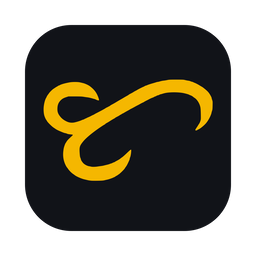

<p align="center"></p>

# Talaan

**Meeting notes that stay on your computer.** Talaan records both sides of any call (your mic and the call's audio), then writes the transcript and a summary with decisions and action items. No bot joins your meeting, and it works with any app: Zoom, Google Meet, Teams, Slack huddles, FaceTime (Mac), Discord, WhatsApp.

*Talaan* is Tagalog for "record". The logo is "ta" in Baybayin, the native Filipino script.

**Status:** v1.0 in final testing. Mac (macOS 14.4 or later, Apple silicon) and Windows (Windows 10 version 2004 or later, or Windows 11, on a 64-bit Intel or AMD PC).

## What it does

- **Asks before it records.** When a call app starts using your mic, Talaan offers to record (every app, Zoom included, starts on Ask). Set any app to Always (with a banner and a one-click notice to paste in the chat) or Never. Dictation apps never trigger it.
- **Transcript, Me and Them.** Your mic is "Me", the call is "Them"; optionally split into Speaker 1, 2, 3 and rename them once.
- **Summary in one format.** Recap, decisions with times, action items with owner and due date, open questions. Click any time to jump there and play it.
- **Ask your meetings.** Questions across all your meetings, answered with links to the exact moment.
- **Edit, copy, export.** Fix a word, then export Markdown, PDF, plain text or to Notion, or copy it as text: the summary, the transcript or both. Import a Voice Memo.
- **Organize.** Folders, tags, calendar titles and attendees.

## Privacy

Everything runs on your computer by default: speech recognition, speaker separation, search and the summary AI, with Wi-Fi off too. On Windows, Whisper and the local summary AI use the graphics card when the PC has one, and the processor otherwise; on the Mac, the graphics chip. Nothing leaves it unless you choose:

| What | When |
|---|---|
| Transcript text | Only if you set Summary AI to your own key (Claude, OpenAI, Gemini, Groq, Cerebras, Mistral, OpenRouter, any OpenAI-compatible service). Never audio. |
| Summary (and transcript if you tick it) | Only when you click Export › Notion. |
| The latest version number from GitHub | At launch and every 6 hours, if "Check for updates automatically" is on. |
| Your calendar (Windows) | Downloaded from the private iCal address you paste, when a recording starts (at most every 15 minutes). Nothing is sent. |
| Usage data, analytics | Never collected. |

Audio is kept 7 days by default (1 day to forever, or not at all), then deleted; choose **Keep audio forever** on a meeting to keep its audio. Meetings are plain files, readable without the app: `~/Library/Application Support/Talaan` on the Mac, `%APPDATA%\Talaan` on Windows. Settings › Privacy › Delete everything removes it all, including models and keys.

## Install

Download from [Releases](https://github.com/mmnzns/Talaan/releases/latest). Step by step: [docs/INSTALL.md](docs/INSTALL.md).

- **Windows:** run `Talaan_<version>_x64-setup.exe`. It installs for your account only, with no administrator password. Windows SmartScreen says "Windows protected your PC" the first time: click **More info**, then **Run anyway**. Talaan isn't signed with a paid certificate; it's free, and built from this source code.
- **Mac:** open the `.dmg` and drag Talaan to Applications. macOS blocks it twice (the `.dmg`, then the app): click **Done**, then **System Settings › Privacy & Security › Open Anyway**. Only once.

Then follow the setup: allow the microphone (and system audio on the Mac), pick a speech model, choose how summaries are written. If a call doesn't record or summarize, **Settings › Status** (the first tab) says what to fix. Updates install from Settings › General and keep your meetings and settings.

## Models

Downloaded on demand, checked by checksum, kept on your computer. Licenses in [THIRD_PARTY_NOTICES.md](THIRD_PARTY_NOTICES.md).

| Job | Model | Size |
|---|---|---|
| Speech, "Best for most people" (recommended) | Whisper Large Turbo (OpenAI) | 575 MB |
| Speech, "Fastest" (25 European languages; much quicker on a PC without a graphics card) | Parakeet v3 (NVIDIA) | 671 MB |
| Speech, "For older computers" | Whisper Small (OpenAI) | 488 MB |
| Speech (more choices) | Whisper Large v3, Large v2, Medium, Base, Tiny (OpenAI); Parakeet Ultra, Parakeet v2, Parakeet Unified, Nemotron 3.5 (NVIDIA) | 78 MB to 2.6 GB |
| Summaries | Qwen3.5 4B (recommended) or 9B | 2.7 / 5.7 GB |
| Speaker separation (optional) | Nemotron 3 Diarization (NVIDIA) | 401 MB |
| Search by meaning (optional) | Qwen3-Embedding 0.6B | 640 MB |

Already have Ollama or LM Studio? Point Summary AI at it instead.

## Build from source

- Mac: requires Rust, Node 22 and the Xcode Command Line Tools.
- Windows: requires Rust (`x86_64-pc-windows-msvc`), Node 22, Visual Studio Build Tools with C++, CMake and LLVM (`LIBCLANG_PATH` set to its `bin`).

```bash
npm install
npm run tauri dev
```

Tests: `npm test` and `cargo test --manifest-path src-tauri/Cargo.toml --workspace`. `npm run dev` shows the UI in a browser with sample data.

Permissions (microphone, system audio, calendar, browser automation) are tied to the app's signature, so test them in a signed build: `scripts/build-signed-debug.sh`. Releases: push a `v*` tag: CI builds Windows (`scripts/release-windows.ps1`) and drafts the release; build the Mac side with `scripts/release-local.sh`, then `scripts/upload-mac-release.sh <tag>`.

## Reporting a bug

Open **Settings › Status**, scroll to **Something not working?** and click **Copy diagnostics**: it shows the report first (app version, these checks, settings without names or keys, and the end of Talaan's log, never what was said), then copies it. **Report a problem** opens a new [issue](https://github.com/mmnzns/Talaan/issues); paste the report there. The log file itself is in `~/Library/Logs/Talaan/` on a Mac and `%LOCALAPPDATA%\com.craftconceptsdigital.talaan\logs\` on Windows (**Open log folder** shows it). More in [docs/INSTALL.md](docs/INSTALL.md#reporting-a-problem).

## Support

Talaan is free and open source. If it saves you time, you can [buy me a coffee](https://buymeacoffee.com/mnmnzns).

## License

MIT. Third-party libraries, fonts and models are listed in [THIRD_PARTY_NOTICES.md](THIRD_PARTY_NOTICES.md).
